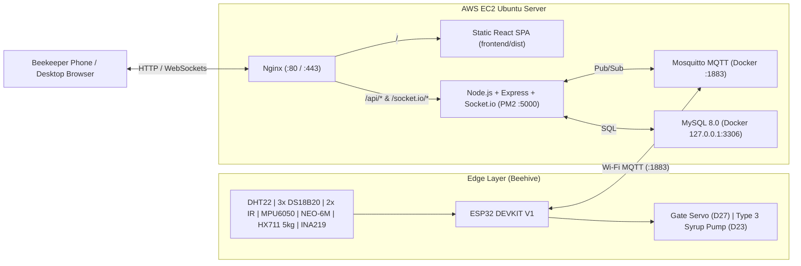

# ApisGuard — Final Project Report & System Overview

**Smart IoT Beehive Monitoring, Anti-Theft & Automated Feeding System**  
**Core Innovative Technologies:** Internet of Things (IoT) & Cloud Computing (AWS EC2)

---

## 1. Executive Summary

**ApisGuard** is an end-to-end smart beekeeping platform designed to monitor hive health, detect theft or physical falls, track real-time GPS location, predict honey harvest readiness, and automate hive protection and emergency feeding.

The system connects an **ESP32 DEVKIT V1** edge node (equipped with 7 sensor groups and 2 physical actuators) to an **AWS Ubuntu EC2** cloud server hosting **Eclipse Mosquitto (MQTT)**, **MySQL 8.0**, **Node.js/Express + Socket.io**, and a **React + TypeScript** web dashboard served through **Nginx**.

---

## 2. Two Core Innovative Technologies

### 2.1 Internet of Things (IoT)
- **Multi-Sensor Edge Node (`ESP32 DEVKIT V1`)**: Continuously samples hive climate (`DHT22`), 3-level vertical thermal distribution (`3x DS18B20`), bee foraging traffic (`2x IR` via hardware interrupts), physical tilt/theft (`MPU6050`), GPS coordinates (`NEO-6M`), hive weight (`HX711 + 5 kg` load cell), and battery capacity (`INA219`).
- **Bi-Directional MQTT Messaging**: Uses lightweight publish/subscribe messaging (`apisguard/telemetry`, `apisguard/actuators/set`, `apisguard/actuators/ack`, `apisguard/alerts`) for low-bandwidth remote telemetry and real-time actuator control.
- **Closed-Loop Edge Automation**: Automatically triggers emergency sugar syrup feeding and high-priority alerts when hive conditions cross safe thresholds.

### 2.2 Cloud Computing (AWS EC2)
- **Containerized Cloud Services**: **MySQL 8.0** and **Eclipse Mosquitto** run inside **Docker** containers on an **AWS Ubuntu EC2** instance.
- **Cloud API & Real-Time Streaming**: The **Node.js + Express + Socket.io** backend runs under **PM2** on EC2, evaluating automation rules, persisting time-series records in MySQL, and pushing live WebSocket updates to clients.
- **Public Cloud Web Hosting**: **Nginx** serves the compiled React dashboard (`frontend/dist`) on port `80` and reverse-proxies `/api/` and `/socket.io/` to the backend, making the dashboard accessible from any mobile phone or desktop browser.

---

## 3. Full AWS System Architecture

---

## 4. Hardware & Edge Layer (`ESP32 DEVKIT V1`)

### 4.1 Power Subsystem
- **Battery Pack**: 4-cell battery holder (`4S`) with inline **Main Power Switch** on the positive (`+`) line.
- **Current/Voltage Sensing**: `INA219` placed in series between the Switch output (`VIN+`) and the Buck Converter (`VIN-`) to measure live battery voltage and current draw.
- **Regulated Power Rails**: Buck Converter tuned to **`5.00 V`** (`OUT+`/`OUT-`) with a **`1000 µF` electrolytic capacitor** across `5.00 V` and `GND` to absorb servo/pump startup spikes.
- **Split Breadboard Rails**: `5.00 V` feeds ESP32 `VIN`, Gate Servo, Type 3 Pump, and `NEO-6M` `VCC`; ESP32 `3V3` feeds low-power `3.3 V` sensors (`DHT22`, `DS18B20`, `MPU6050`, `INA219`, `HX711`, `2x IR`), all sharing a common `GND`.

### 4.2 Sensors & Actuators Pinout

| Component | Model | Interface / ESP32 Pin | Function |
| :--- | :--- | :--- | :--- |
| **Temp & Humidity** | `DHT22` (3-pin) | Digital (`D4` / `GPIO 4`) | Hive temperature (`°C`) and relative humidity (`%`) |
| **3-Level Thermal Probes** | `3x DS18B20` Waterproof | 1-Wire (`D19` / `GPIO 19`, `4.44 kΩ` pull-up) | Top, Middle, and Bottom vertical temperatures for 2D heat map |
| **Bee Traffic Counter** | `2x IR` Obstacle Sensors | Hardware Interrupts (`D32` Outer, `D33` Inner) | Counts bees entering and exiting the hive in microseconds |
| **Theft & Fall IMU** | `MPU6050` | Shared I2C (`D21` SDA, `D22` SCL) | Detects hive tilt, physical falls, and tampering |
| **Battery Monitor** | `INA219` | Shared I2C (`D21` SDA, `D22` SCL) | Measures battery voltage (`V`), current (`mA`), and `%` |
| **GPS Tracker** | `NEO-6M` GPS | Hardware UART2 (`RX2`=`16`, `TX2`=`17`) | Live latitude, longitude, altitude, and satellite count |
| **Weight & Harvest Scale** | `HX711 + 5 kg` Load Cell | Digital (`D25` DT, `D26` SCK) | Tracks hive weight (`0–5 kg`), rapid drops, and harvest readiness |
| **Entrance Gate** | Servo Motor (`MG996R`/Servo) | PWM (`D27` / `GPIO 27`) | 3 positions: `OPEN` (`0°`), `GUARD_MODE` (`45°`), `CLOSED` (`90°`) |
| **Syrup Dispenser** | `Type 3` Submersible Pump | Relay/MOSFET (`D23` / `GPIO 23`) | Timed emergency sugar syrup feeding |

---

## 5. Cloud Backend, MQTT & Database (`backend/` + AWS Docker)

### 5.1 MQTT Topic Protocol
- `apisguard/telemetry` (`ESP32 -> Backend`): Periodic JSON containing DHT22, 3x DS18B20 `thermalProbes`, `weightKg`, `beesIn`/`beesOut`, MPU6050 `motion`, `NEO-6M` GPS `location`, and `INA219` battery metrics.
- `apisguard/status` (`ESP32 -> Backend`): Device heartbeat & connectivity.
- `apisguard/actuators/set` (`Backend -> ESP32`): Remote or automated commands for `entranceGate` and `syrupDispenser`.
- `apisguard/actuators/ack` (`ESP32 -> Backend`): Hardware execution confirmations synced to the dashboard via `Socket.io` (`actuators:ack`).
- `apisguard/alerts` (`Backend -> Subscribers`): Real-time alert notifications.

### 5.2 MySQL 8.0 Schema (6 Tables)
1. `users`: Beekeeper profile records.
2. `telemetry`: Time-series sensor, 3-probe thermal, IR traffic, MPU6050 motion, GPS, and INA219 battery rows indexed by `recorded_at DESC`.
3. `actuators`: Persistent state and `is_auto_mode` flags for `entrance_gate` and `syrup_dispenser`.
4. `actuator_logs`: Audit trail of `manual_web` and `auto_rule` commands with execution status.
5. `alerts`: Incident log (`HIGH_TEMP`, `LOW_TEMP`, `THEFT_TAMPER`, `HIVE_FALL`, `RAPID_WEIGHT_LOSS`, `HARVEST_READY`, `GEOFENCE_BREACH`, `LOW_BATTERY`) with resolution tracking.
6. `settings`: Configurable thresholds (`home_latitude`, `home_longitude`, `geofence_radius_meters = 50`, `max_temp_threshold = 36.00`, `rapid_weight_loss_kg = 0.50`, `harvest_weight_kg = 4.20`, `scale_tare_offset`).

### 5.3 Backend REST API & Automation Rules
- **REST Endpoints**: `GET /api/health`, `GET /api/telemetry/latest`, `GET /api/telemetry/history`, `GET /api/actuators`, `POST /api/actuators/command`, `GET /api/alerts`, `PATCH /api/alerts/:id/resolve`, `GET /api/logs`, and `GET /api/settings`.
- **Automated Rules** ([automation.ts](./backend/src/services/automation.ts)):
  - **High Temperature**: `temperature > 36.00 °C` $\rightarrow$ `HIGH_TEMP` alert.
  - **GPS Geofence**: Haversine distance `> 50 m` from home base $\rightarrow$ `GEOFENCE_BREACH` critical alert.
  - **Fall & Theft**: MPU6050 `fallDetected` or `theftAlert` $\rightarrow$ `HIVE_FALL` / `THEFT_TAMPER` critical alert.
  - **Rapid Weight Loss + Auto Syrup**: Weight drop `>= 0.50 kg` $\rightarrow$ `RAPID_WEIGHT_LOSS` alert + automatic `Type 3` pump command (`apisguard/actuators/set`) when `AUTO` mode is enabled.
  - **Harvest Ready**: `weightKg >= 4.20 kg` $\rightarrow$ `HARVEST_READY` info alert.
  - **Low Battery**: `batteryPct <= 20%` $\rightarrow$ `LOW_BATTERY` warning alert.

---

## 6. Web Dashboard (`frontend/`)

### 6.1 Looseleaf Paper-and-Ink Design System
The frontend uses a custom hand-drawn paper aesthetic inspired by **`kevintngo/looseleaf`**:
- **Typography**: Bundled MIT-licensed **Kevin Sans** (`KevinSans-Regular.woff2`, `KevinSans-Bold.woff2`).
- **Seeded SVG Pen Frames**: [InkFrame.tsx](./frontend/src/components/InkFrame.tsx) draws deterministic, wobbly hand-drawn `<svg data-ink>` borders around cards, buttons, pills, alerts, and popovers.
- **Light & Dark Paper Themes**: Switchable anytime via **Settings** in [Navbar.tsx](./frontend/src/components/Navbar.tsx) (Light: sage craft desk `#a8c8bb` + cream paper `#f8f5ee`; Dark: slate desk `#181a1f` + charcoal sketchpad `#22252c`).

### 6.2 Four Categorized Pages (Desktop + Mobile Bottom Nav)
1. **Overview (`/`)**: Active alert banner, **Leaflet** live GPS & `50 m` geofence map (`Carto Voyager` + `Esri Satellite` toggle + external Google Maps link), 4 KPI cards (`Hive Climate DHT22`, `Hive Weight 5kg`, `Bee Traffic 2x IR`, `Motion MPU6050`), and quick-status tiles.
2. **Controls (`/controls`)**: 3-state **Entrance Gate Servo** (`Open`, `Guard`, `Closed`) and **Sugar Syrup Dispenser** (`AUTO`/`MANUAL` toggle + manual `Dispense Syrup` trigger).
3. **Charts (`/charts`)**: 24-hour summary cards and tabbed visualizations (**Temp & Humidity**, **2D Heat Map** for `Top`/`Middle`/`Bottom` DS18B20 probes, and **Weight Flow**).
4. **Logs (`/logs`)**: Active alerts + filterable incident & actuator command history (`all`, `actuator`, `alert`, `system`).

---

## 7. Implementation & Verification Summary

| Project Area | Status | Notes |
| :--- | :--- | :--- |
| **Frontend (`frontend/`)** | Built & Verified | `tsc --noEmit && vite build` passed (`579` modules); Looseleaf Light/Dark themes & Leaflet map integrated |
| **Backend (`backend/`)** | Built & Verified Locally | `tsc` build passed; REST endpoints & in-memory fallback verified locally |
| **AWS Hosting Guide** | Documented | Full single-file setup in [AWS_SERVER_SETUP.md](./AWS_SERVER_SETUP.md) (Docker MySQL + Mosquitto + PM2 + Nginx) |
| **Hardware Sensors** | In Progress | Bench-tested: Power stage, `DHT22`, `3x DS18B20`, `NEO-6M` UART, `2x IR` interrupts, `Gate Servo`. Pending: `MPU6050`/`INA219` I2C check, `HX711`, `Type 3 Pump`, and unified `firmware/` |
